# Webshop Mobile Application

## Webshop — React Native (Expo) e-commerce client and optional mock API under `backend/`.

## Technologies Used

- React Native
- Redux Toolkit
- RTK Query
- Expo Router
- NativeWind

## Preface

`Webshop` is an e-commerce App with an elegant interface, rich functions, small size and speed.
It contains the complete functions of an e-commerce platform MVP and has good aesthetic style and coding design.

## Feature Demo

- Feed
- Category
- Classification subset
- Product details
- Product review
- Cart
- Payment
- Profile
- Authentication design
- Orders List
- Reviews List
- Personal Info Screen
- Addresses Screen
- Search Screen

## Screenshots

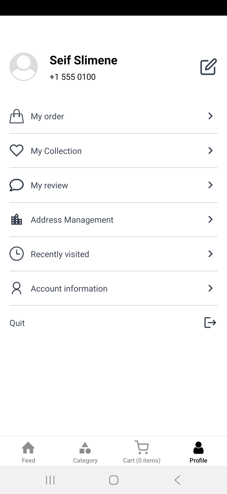


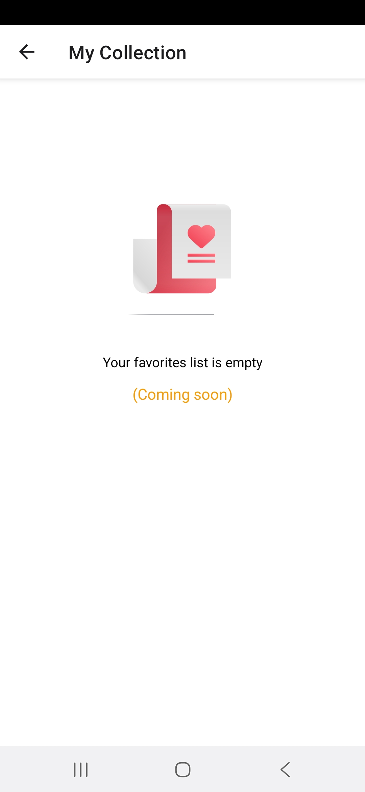

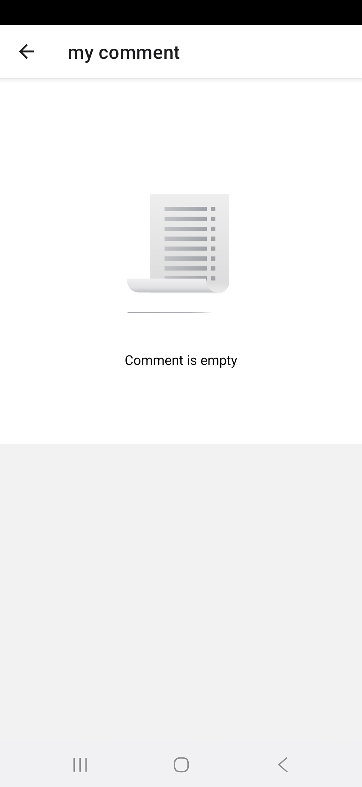

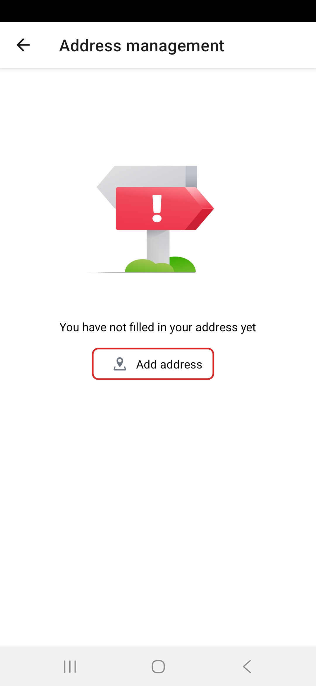

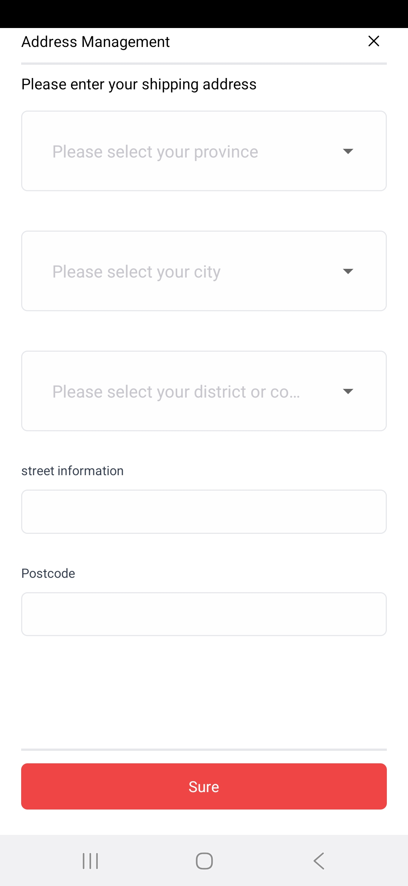

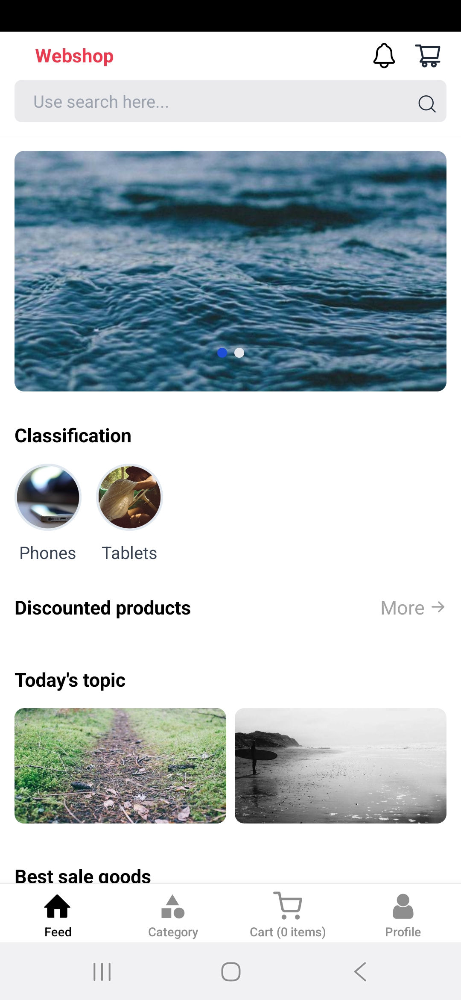

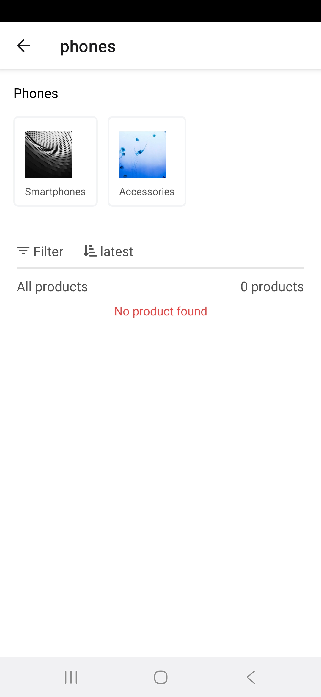

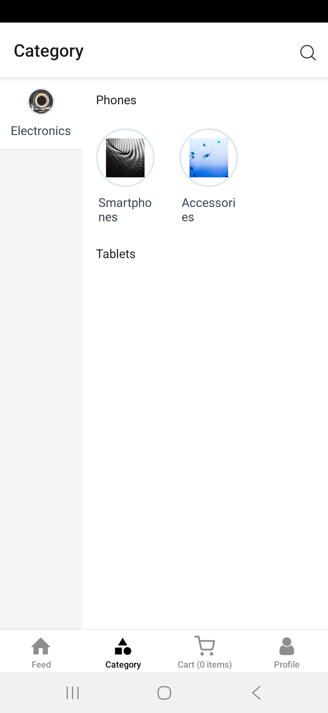

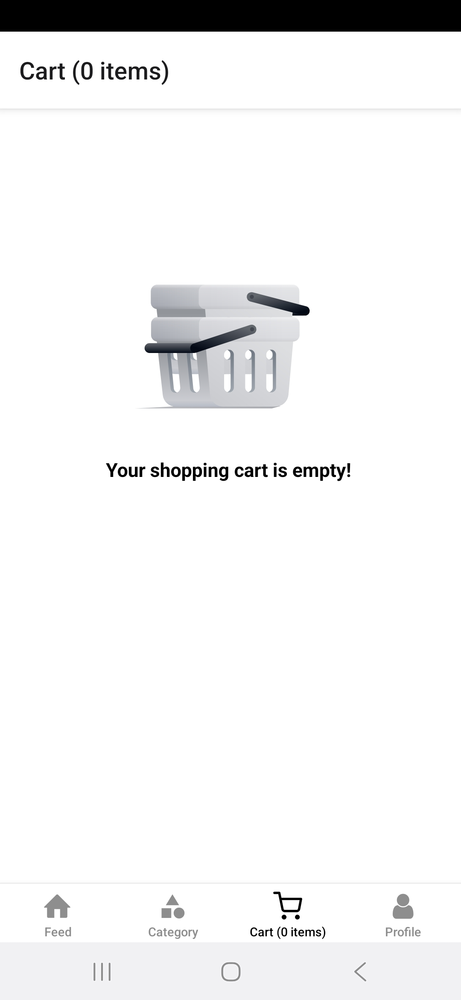

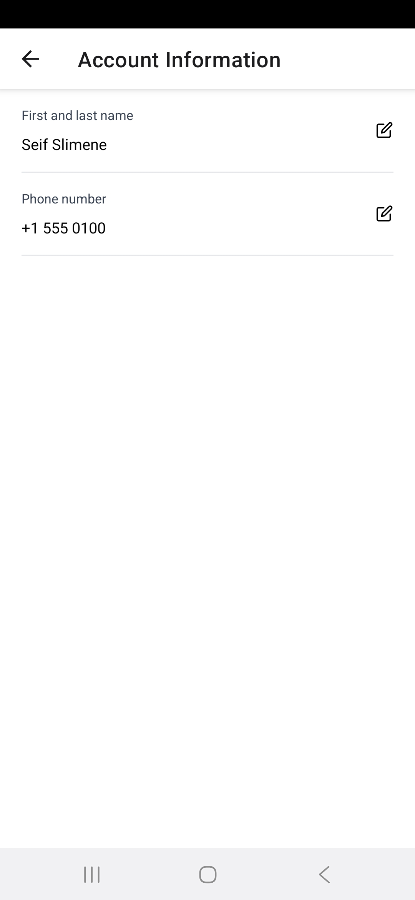

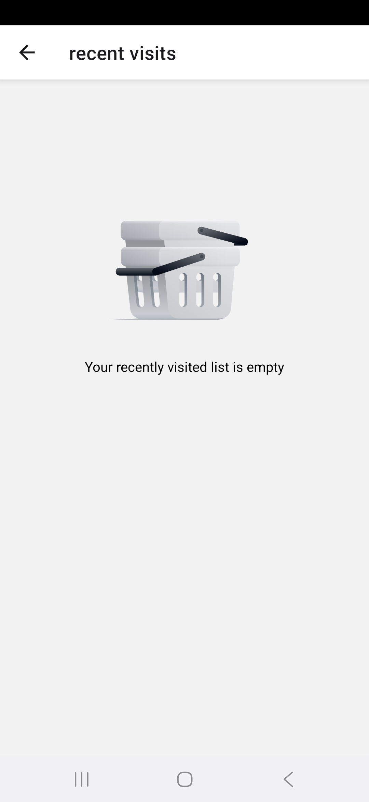

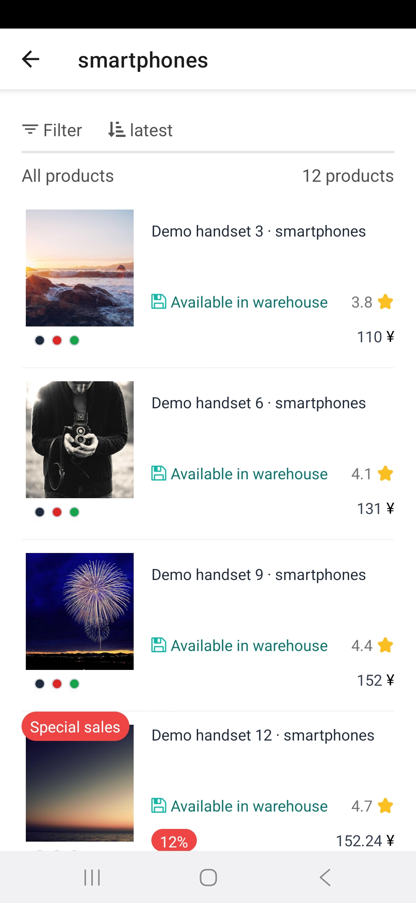

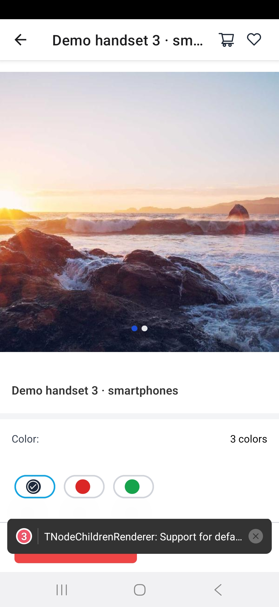

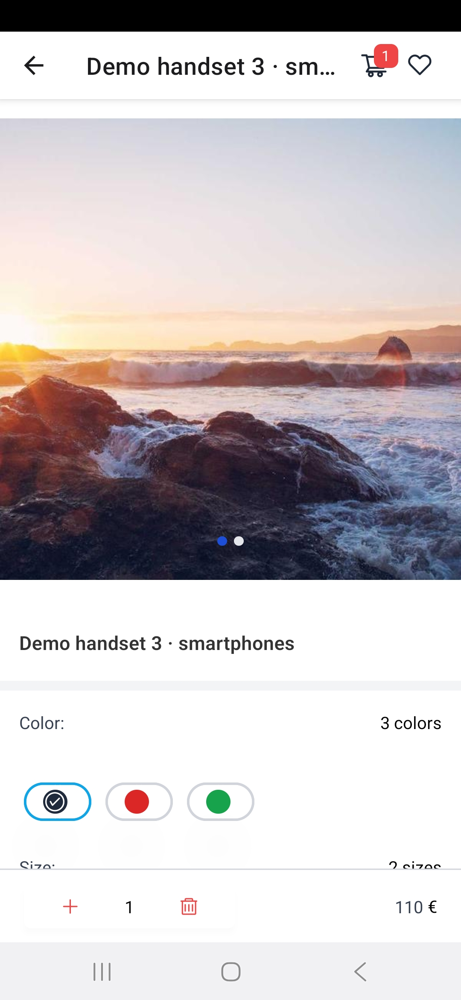

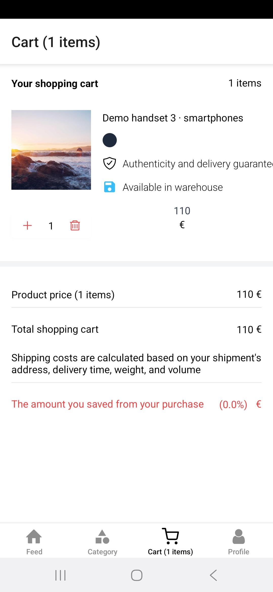

## Usage

To run the Webshop React Native app locally, follow these steps:

1. Clone the repository:

   ```bash
   git clone https://github.com/seifeslimene/webshop.git
   ```

2. Navigate to the project directory:

   ```bash
   cd webshop
   ```

3. Install dependencies:

   ```bash
   npm install
   ```

   After install, `patch-package` runs automatically (via `postinstall`) to apply patches under `patches/`.

   **If `npm install` fails with `patch-package: Permission denied` (exit code 126):** the `node_modules/.bin` shims may have lost their execute bit (common after copying `node_modules` or on some Windows/WSL setups). This repo calls patch-package through Node in `package.json` to avoid that; if you still see errors, reinstall clean copies of dependencies and ensure you run `npm install` from WSL using Linux Node when the project lives under your Linux home directory (`~/...`). As a one-off fix you can run:

   ```bash
   chmod +x node_modules/.bin/*
   ```

4. Please create a new `.env` file from `.env.example` file in the project root directory to define the required environment variables.

   Eg:

   ```bash
   EXPO_PUBLIC_BASE_URL=
   ```

   **Backend (mock API):** this repo includes a small Express server under `backend/` that implements the `/api/...` routes the app expects.

   ```bash
   cd backend && npm install && npm start
   ```

   Or from the project root: `npm run api:dev`. It listens on **port 3000** on all interfaces (`0.0.0.0`) so devices on your LAN can reach it. Seeded accounts: **`demo@example.com`** / **`demo123`**, **`admin@gmail.com`** / **`123456`**.

   Point the app at it by setting `EXPO_PUBLIC_BASE_URL=http://127.0.0.1:3000` (or your machine’s LAN IP). Verify with `npm run check-api` or `node scripts/check-api.mjs http://127.0.0.1:3000`.

5. Start the development server:

   ```bash
   npm start
   ```

6. Connect your mobile device or emulator to run the app.
